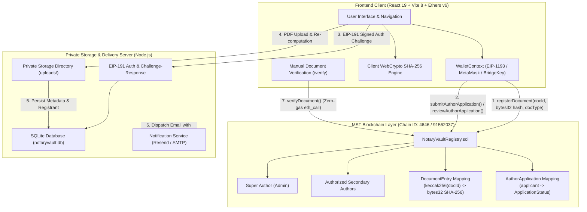
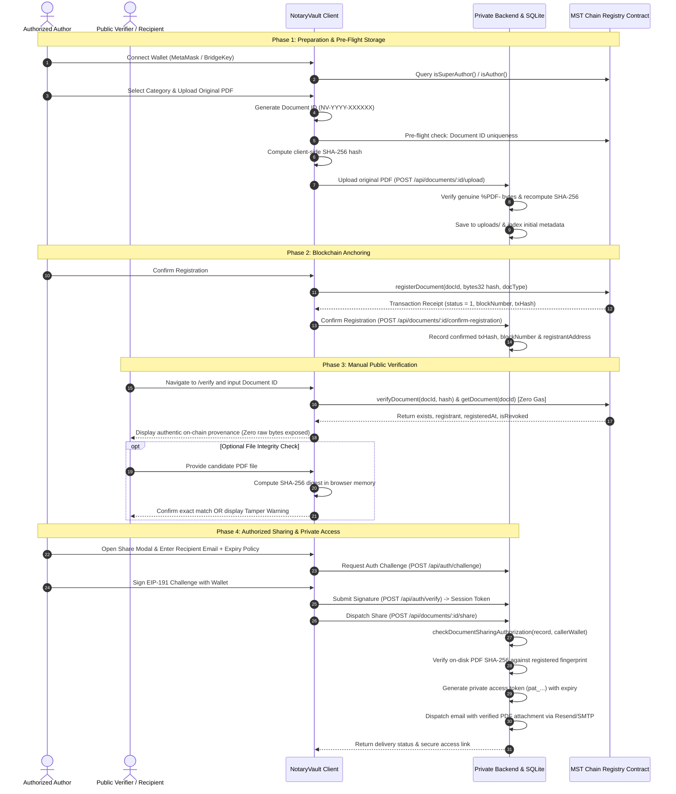

# NotaryVault — Blockchain-Based Document Verification & Tracking

<div align="center">


**Decentralized, tamper-evident document notarization, cryptographic provenance tracking, and access-controlled sharing anchored on MST Chain.**

[](https://notary-vault-woad.vercel.app)
[](https://drive.google.com/file/d/1m5ID2r3Kta8ItnuWBTuoh6bieDrV_OAw/view?usp=sharing)
[-8B5CF6?style=flat-square)](https://mstscan.com)
[](contracts/NotaryVaultRegistry.sol)
[](package.json)
[](tsconfig.json)
[](package.json)
[-10B981?style=flat-square)](scripts/test-runner.js)
[](LICENSE)

[Live App (Vercel)](https://notary-vault-woad.vercel.app) • [Demo Video](https://drive.google.com/file/d/1m5ID2r3Kta8ItnuWBTuoh6bieDrV_OAw/view?usp=sharing) • [System Architecture](#-system-architecture) • [Core Workflow](#-end-to-end-application-workflow) • [Smart Contracts](#-smart-contract-architecture) • [Deployment Records](#-mst-chain-deployment-information) • [Local Setup](#-installation--local-development) • [Production Deployment](#-production-deployment-architecture)

</div>

---

## 📌 Executive Summary & Problem Statement

Document fraud, unauthorized deed alterations, forged power of attorney instruments, and title duplication inflict billions of dollars in global financial and legal damages annually. Traditional document verification workflows suffer from severe structural vulnerabilities:

1. **Vulnerability to Centralized Tampering**: Centralized document repositories and physical paper archives can be altered, overwritten, or misplaced without an immutable audit trail.
2. **Lack of Instant Public Verifiability**: Verifying whether a property deed or legal instrument is authentic typically requires lengthy manual courthouse or institutional requests.
3. **Data Privacy vs. Blockchain Transparency Conflict**: Storing raw confidential legal documents directly on a public blockchain violates party privacy and data compliance regulations (e.g., GDPR, CCPA).
4. **Fragile Link Sharing**: Common file-sharing tools expose full documents via public, unauthenticated URLs that cannot be revoked, expired, or cryptographically tied to the authorized registrant.

### The NotaryVault Solution

**NotaryVault** addresses these challenges through a **hybrid on-chain cryptographic anchoring and confidential off-chain storage architecture**:

- **Zero-Knowledge On-Chain Anchoring**: Only the canonical Document ID (`NV-YYYY-XXXXXX`), a cryptographic SHA-256 fingerprint (`bytes32`), the authorized registrant's wallet address, and the block timestamp are anchored on the **MST Chain** smart contract registry. **Raw PDF binary bytes are NEVER stored on the blockchain**.
- **On-Chain Role-Based Access Control (RBAC)**: A three-tiered permission hierarchy (**Super Author**, **Secondary Author**, and **Public User**) ensures only credentialed authorities can notarize documents, while anyone can publicly verify them.
- **Manual Document Verification Engine**: Anyone can verify an instrument by looking up its Document ID on the public verification portal (`/verify`) or in-app (`/app/verify`) to query real-time blockchain provenance (zero gas `eth_call`). Verifiers can also drop a PDF into the portal to recalculate its SHA-256 digest in client memory and verify byte-for-byte authenticity against the on-chain fingerprint.
- **Confidential Storage & Authorized Sharing**: Original PDF bytes are stored securely off-chain in private server storage (SQLite + protected file directory). Document sharing and private downloads are strictly restricted to the registered owner, the authorized secondary author who registered the document, and the Super Author, protected by cryptographic wallet signatures (EIP-191) and time-bounded access tokens (`pat_...`).

---

## 🚀 Live Deployment & Demo

### 🌐 Live Deployment
[](https://notary-vault-woad.vercel.app)  
> **Live Production URL**: [https://notary-vault-woad.vercel.app](https://notary-vault-woad.vercel.app)

### 🎥 Demonstration Video
[](https://drive.google.com/file/d/1m5ID2r3Kta8ItnuWBTuoh6bieDrV_OAw/view?usp=sharing)  
> **Walkthrough Video**: [Watch NotaryVault Demo Video on Google Drive](https://drive.google.com/file/d/1m5ID2r3Kta8ItnuWBTuoh6bieDrV_OAw/view?usp=sharing)

---

## ✨ Key Features & Capabilities

### 🔐 1. Cryptographic Document Registration & Anchoring
- **Client-Side SHA-256 Hashing**: Calculates the standard 256-bit SHA-256 digest in client memory before transmission using the browser WebCrypto API (`crypto.subtle.digest('SHA-256')`).
- **Canonical Document ID Generation**: Generates collision-resistant identifiers in the standard format `NV-YYYY-XXXXXX` (e.g., `NV-2026-865396`).
- **Multi-Layer Duplicate Checking**: Pre-flight verification simultaneously validates the candidate ID against the active smart contract, historical contract registries, and the local catalog.
- **On-Chain Transaction Confirmation**: Dispatches transactions to `NotaryVaultRegistry.sol` on MST Chain (Testnet or Mainnet) and awaits real on-chain confirmation (`receipt.status === 1`), capturing the block number, timestamp, and transaction hash.

### 🔍 2. Manual Verification & Tamper Detection
- **Zero-Gas Public Verification**: Anyone can navigate to `/verify` or deep-link to `/verify/:documentId` to query on-chain provenance directly from the smart contract without gas fees or wallet connection.
- **File Integrity Matching**: Verifiers can provide a candidate PDF to recalculate its SHA-256 hash in client memory. If a single byte has been modified, a prominent **Tampered Document Warning** is displayed.
- **Zero Raw Byte Exposure**: Public verification pages display only registration metadata (Document ID, SHA-256 hash, document category, issuer name, registrant address, block number, and timestamp). Raw PDF bytes remain private and inaccessible to unauthenticated parties.

### 👥 3. Three-Tier Role Governance & Author Management
- **Super Author (Admin)**: Full governance authority. Deploys contracts, reviews on-chain author applications, authorizes and deauthorizes Secondary Authors, registers documents, and shares vault documents according to the administrative permission model.
- **Secondary Author**: Approved notaries, institutions, and legal practitioners. Permitted to register documents on-chain (`onlyAuthor`), manage owned records, and share documents they registered or own.
- **Public User**: Can connect their wallet, perform zero-gas verifications, inspect public metadata, and submit an on-chain application to become an authorized Secondary Author. Prohibited from registering documents on-chain.

### 🛡️ 4. Private Storage & EIP-191 Cryptographic Authentication
- **Decoupled Confidential Storage**: PDF files are stored on a private backend server outside the public web root.
- **Cryptographic Wallet Ownership Proof (EIP-191)**: Accessing private documents or managing shares requires signing an ephemeral server challenge with the connected wallet (compatible with Ethers v6, MetaMask, and BridgeKey).
- **Time-Bounded Private Access Tokens**: Document owners can generate access tokens (`pat_...`) with configurable expiry policies: `1h`, `24h`, `7d`, `30d`, `90d`, or `No Fixed Expiry`. Tokens are hashed (`SHA-256`) before database storage.
- **Instant Revocation**: Document owners can revoke active access tokens at any time, immediately disabling download access.

### 📧 5. Multi-Channel Document Sharing & Delivery Diagnostics
- **Authorized Sharing**: Only the document owner, the secondary author who registered the document, or the Super Author can initiate sharing.
- **Transactional Email Delivery**: Dispatches certified document copies with verified PDF attachments via **Resend** or standard **SMTP**.
- **State-Accurate Delivery Diagnostics**: Accurately distinguishes token creation, provider acceptance (`Accepted by Provider` with delivery reference ID), and provider failure (`Delivery Failed` with actionable diagnostics, such as domain verification requirements). A failed email is never falsely reported as delivered.
- **Direct Access Link Sharing**: Allows generating secure access links without triggering email dispatch.
- **SMS Status**: Mobile/SMS sharing is marked as **Coming Soon** in the UI with inputs disabled pending carrier brand registration.

---

## 🛠️ Complete Technology Stack

| Layer | Technology | Version | Purpose in NotaryVault |
|:---|:---|:---|:---|
| **Frontend Framework** | **React** | `19.3.1` | Reactive UI, declarative views, and application state |
| **Build Tool & Bundler** | **Vite** | `8.3.5` | Fast HMR dev server and optimized production build |
| **Language** | **TypeScript** | `~7.0.2` | Static typing, interface contracts, and compile-time verification |
| **Web3 Provider & Signer** | **Ethers.js** | `6.17.0` | Contract interaction, EIP-1193 wrapping, and EIP-191 personal signing |
| **Smart Contracts** | **Solidity** | `0.8.28` | Immutable document registry, on-chain RBAC, and hash indexing |
| **Contract Compiler** | **solc** | `0.8.28` | Standalone contract compilation generating bytecode and ABIs |
| **Styling & Design System** | **Tailwind CSS** | `3.4.19` | Responsive design system with custom color tokens |
| **UI Component Icons** | **Lucide React** | `1.62.0` | Lightweight vector icons across all views |
| **Client Routing** | **React Router DOM** | `7.18.4` | Client-side routing, deep linking, and RBAC route guards |
| **Backend Runtime** | **Node.js (ESM)** | `v22+` | Standalone HTTP API server for off-chain storage and auth |
| **Database** | **node:sqlite (`DatabaseSync`)** | Built-in | Native SQLite database for document metadata and access tokens |
| **Transactional Email** | **Resend / Nodemailer** | REST / SMTP | Email delivery with verified PDF attachments |
| **Development Blockchain** | **Hardhat** | `3.21.1` | Local EVM node simulation for testing and deployment |
| **Automated Test Suite** | **Node.js Test Runner / Chai**| `4.5.0` | Comprehensive 24-suite contract and workflow test harness |
| **Linter** | **Oxlint** | `1.89.0` | High-performance Rust-based JavaScript/TypeScript linter |

---

## 🏗️ System Architecture



---

## 🔄 End-to-End Application Workflow



### Detailed Workflow Phases

#### 1. Wallet Connection & Network Detection
- The client connects to the user's EVM browser wallet via Ethers v6.
- Automatically detects the active chain ID:
  - **MST Chain Mainnet**: Chain ID `4646` (`0x1226`)
  - **MST Chain Testnet**: Chain ID `91562037` (`0x5752035`)
- If connected to an unsupported network, the interface prompts the user to switch networks before executing transactions.

#### 2. Role Verification & Governance Lifecycle
- Queries `isSuperAuthor(address)` and `isAuthor(address)` on the active contract:
  - **Public User**: Can perform manual verifications and apply on-chain to become an author. Route guards block registration and sharing.
  - **Secondary Author**: Can register documents, manage owned documents, and generate sharing links.
  - **Super Author**: Reviews applications, authorizes/deauthorizes authors, deploys Mainnet contracts, and manages vault documents.
- **Author Application Flow**:
  1. A Public User navigates to `/app/apply-author` and calls `submitAuthorApplication(...)` on-chain.
  2. The application is recorded on-chain with status `Pending`.
  3. The Super Author reviews submissions at `/app/author-applications` and calls `reviewAuthorApplication(...)` to approve (granting author privileges) or reject.

#### 3. Document ID Collision Protection & Pre-Flight Storage
- The author selects a document category and uploads a PDF.
- The system generates a collision-resistant Document ID (`NV-YYYY-XXXXXX`).
- Pre-flight checks concurrently query the active contract, historical contract, and local database to ensure uniqueness.
- The original PDF is uploaded to the private backend storage (`POST /api/documents/:id/upload`) where its SHA-256 digest is re-computed and validated before blockchain submission.

#### 4. Blockchain Anchoring Transaction
- The author signs the `registerDocument(docId, documentHash, docType)` transaction in their wallet.
- The client awaits on-chain confirmation (`receipt.status === 1`), extracting the block number, transaction hash, and timestamp.
- The client notifies the backend (`POST /api/documents/:id/confirm-registration`) to record the confirmed transaction hash and registrant wallet address in SQLite.

#### 5. Manual Document Verification
- Anyone can navigate to `/verify` or `/verify/:documentId` to inspect registration status.
- The client executes zero-gas read-only smart contract calls (`getDocument` and `verifyDocument`).
- Verifiers can optionally supply a candidate PDF. The browser calculates its SHA-256 hash in client memory and compares it against the on-chain hash to verify that the file is authentic and unaltered.
- **Zero Raw Byte Exposure**: Public verification pages never transmit or download raw PDF bytes unless an authorized party presents a valid private access token.

#### 6. Authorized Sharing, Access Tokens & Email Delivery
- Document sharing is restricted to the registered owner, the secondary author registrant, or the Super Author.
- The user authenticates by signing an EIP-191 challenge with their wallet to establish an authenticated session.
- The user selects an access policy (`1h`, `24h`, `7d`, `30d`, `90d`, or `No Fixed Expiry`).
- A private access token (`pat_...`) is generated and hashed (`SHA-256`) in SQLite.
- If email delivery is selected, the server verifies the on-disk file integrity and dispatches the PDF via Resend or SMTP.
- The UI provides clear, state-accurate feedback:
  - **Email Dispatched**: Green banner with provider delivery reference ID.
  - **Delivery Failed**: Actionable error diagnosis (e.g., domain verification needed) while still providing the direct link.
  - **Provider Unconfigured**: Notice that the provider is unconfigured in the environment.

---

## 👥 On-Chain Role-Based Access Control (RBAC)

```
┌────────────────────────────────────────────────────────┐
│                  Super Author (Admin)                  │
│  • Contract Deployer / Master Administrator            │
│  • Authorizes and deauthorizes Secondary Authors       │
│  • Reviews on-chain author applications                │
│  • Registers & revokes documents; transfers admin role │
└───────────────────────────┬────────────────────────────┘
                            │
                            ▼
┌────────────────────────────────────────────────────────┐
│                    Secondary Author                    │
│  • Approved Notaries, Real Estate Registries, Law Firms│
│  • Can register documents on-chain (onlyAuthor)        │
│  • Can share and manage owned documents                │
│  • Cannot authorize other authors or alter governance  │
└───────────────────────────┬────────────────────────────┘
                            │
                            ▼
┌────────────────────────────────────────────────────────┐
│                      Public User                       │
│  • General Public, Verifiers, Property Buyers          │
│  • Read-only manual document verification (Zero gas)   │
│  • Can apply on-chain to become a Secondary Author     │
│  • Strictly prohibited from registering documents      │
└────────────────────────────────────────────────────────┘
```

---

## ⛓️ MST Chain Deployment Information

NotaryVault maintains strict network isolation between **MST Chain Testnet** and **MST Chain Mainnet**.

### 🌐 MST Chain Mainnet (Chain ID: `4646` / `0x1226`)

| Parameter | Active Role-Based Contract | Historical v1 Contract |
|:---|:---|:---|
| **Contract Name** | `NotaryVaultRegistry` | `NotaryVault` (v1 Registry) |
| **Contract Address** | [`0xE25AD72aF5A6561602fF7A6038AD9E5b591c669e`](https://mstscan.com/address/0xE25AD72aF5A6561602fF7A6038AD9E5b591c669e) | [`0xe9097672C2556318f1BD974323174baA43b88514`](https://mstscan.com/address/0xe9097672C2556318f1BD974323174baA43b88514) |
| **Deployment Tx Hash** | [`0x49ef39c1b620b935037a6e8541b63bed170c7fc0563a10ba43b8a1cda751304d`](https://mstscan.com/tx/0x49ef39c1b620b935037a6e8541b63bed170c7fc0563a10ba43b8a1cda751304d) | [`0x3148be636c550e69b70c94111f84aa965f42775ca40aeb92cf2999367eb4d505`](https://mstscan.com/tx/0x3148be636c550e69b70c94111f84aa965f42775ca40aeb92cf2999367eb4d505) |
| **Deployment Block** | `21789582` | `21789102` |
| **Super Author / Admin** | `0x6D9618b1Ee522d22f3C168B40A33466A89af00C4` | `0x6D9618b1Ee522d22f3C168B40A33466A89af00C4` |
| **Primary RPC URL** | `https://mariorpc.mstblockchain.com` | `https://mariorpc.mstblockchain.com` |
| **Block Explorer** | [mstscan.com](https://mstscan.com) | [mstscan.com](https://mstscan.com) |
| **Configuration Status** | **Configured & Active** | **Historical Fallback** |

---

### 🧪 MST Chain Testnet (Chain ID: `91562037` / `0x5752035`)

| Parameter | Active Role-Based Contract | Historical v1 Contract |
|:---|:---|:---|
| **Contract Name** | `NotaryVaultRegistry` | `NotaryVault` (v1 Registry) |
| **Contract Address** | [`0xC4B7ea1B1cE4e95Bad65bf3fd3c7A079720120F3`](https://testnet.mstscan.com/address/0xC4B7ea1B1cE4e95Bad65bf3fd3c7A079720120F3) | [`0xe9097672C2556318f1BD974323174baA43b88514`](https://testnet.mstscan.com/address/0xe9097672C2556318f1BD974323174baA43b88514) |
| **Deployment Tx Hash** | [`0x7c0f6122c4c9d4d2e937fdd98d05a5a0c398372df9ffa682f04b6cb1483aed56`](https://testnet.mstscan.com/tx/0x7c0f6122c4c9d4d2e937fdd98d05a5a0c398372df9ffa682f04b6cb1483aed56) | [`0x7fbc35a3cc8b7de8ff99154b29dfc2d890c5c2400820c107938dfe0a116b5344`](https://testnet.mstscan.com/tx/0x7fbc35a3cc8b7de8ff99154b29dfc2d890c5c2400820c107938dfe0a116b5344) |
| **Deployment Block** | `6650784` | `6644251` |
| **Super Author / Admin** | `0x6D9618b1Ee522d22f3C168B40A33466A89af00C4` | `0x6D9618b1Ee522d22f3C168B40A33466A89af00C4` |
| **Primary RPC URL** | `https://testnetrpc.mstblockchain.com` | `https://testnetrpc.mstblockchain.com` |
| **Block Explorer** | [testnet.mstscan.com](https://testnet.mstscan.com) | [testnet.mstscan.com](https://testnet.mstscan.com) |
| **Configuration Status** | **Configured & Active** | **Historical Fallback** |

> **Architectural Distinction**:
> - **Historical Contract (`0xe909...8514`)**: Used during early prototyping for simple document anchoring.
> - **Active Role-Based Registry Contracts (`0xC4B7...` on Testnet, `0xE25A...` on Mainnet)**: Feature complete role-based author governance (`authorizedAuthors`), on-chain author application review (`submitAuthorApplication` / `reviewAuthorApplication`), and lifecycle revocation. The application continues to verify historical records while routing all new registrations to the active contract.

---

## 📜 Smart Contract Architecture

The primary contract [`NotaryVaultRegistry.sol`](file:///d:/dapp/contracts/NotaryVaultRegistry.sol) is compiled with Solidity `0.8.28`.

### Core Interface

```solidity
// --- Document Registration & Lifecycle ---
function registerDocument(string calldata docId, bytes32 documentHash, uint8 docType) external returns (bool);
function revokeDocument(string calldata docId, string calldata reason) external returns (bool);
function recordAuditEvent(string calldata docId, bytes32 eventType, string calldata remarks) external returns (bool);

// --- Zero-Gas Public Verification (eth_call) ---
function verifyDocument(string calldata docId, bytes32 submittedHash) external view returns (
    bool isValid,
    bool exists,
    address registrant,
    uint64 registeredAt,
    bool isRevoked
);

function getDocument(string calldata docId) external view returns (
    bytes32 documentHash,
    address registrant,
    uint64 registeredAt,
    uint8 docType,
    bool isRevoked,
    string memory canonicalDocId
);

// --- Author Governance & RBAC ---
function authorizeAuthor(address author) external returns (bool);
function deauthorizeAuthor(address author) external returns (bool);
function submitAuthorApplication(string calldata appId, string calldata name, string calldata org, string calldata email, string calldata justification) external returns (bool);
function reviewAuthorApplication(address applicant, bool approve, string calldata reviewNotes) external returns (bool);
function transferSuperAuthor(address newSuperAuthor) external returns (bool);
function isAuthor(address account) external view returns (bool);
function isSuperAuthor(address account) external view returns (bool);
```

### Security Guards in the Contract:
1. `EmptyDocumentId` & `ZeroDocumentHash`: Disallows empty identifiers or zeroed hashes.
2. `DocumentAlreadyExists`: Prevents Document ID collision or overwriting.
3. `HashAlreadyRegistered`: Rejects duplicate registration of identical file hashes.
4. `onlyAuthor` Modifier: Restricts document registration strictly to the Super Author and approved Secondary Authors.
5. Non-renounceable Administration: `transferSuperAuthor` requires a validated non-zero address to prevent contract abandonment.

---

## 💻 Installation & Local Development

### Prerequisites
- **Node.js**: `v22.0.0` or higher (tested on `v24.21.0` with native `node:sqlite`)
- **npm**: `v9.0.0` or higher
- An EVM browser wallet (MetaMask or BridgeKey) configured for MST Chain Testnet or Mainnet.

### Step 1: Clone Repository & Install Dependencies
```bash
git clone https://github.com/yashdjadhav08-del/NotaryVault.git
cd NotaryVault
npm install
```

### Step 2: Environment Configuration
Copy the sample environment file:
```bash
cp .env.example .env
```

Configure parameters in `.env` (never commit secrets to version control):
```ini
# MST Chain RPC Endpoints
MST_TESTNET_RPC_URL=https://testnetrpc.mstblockchain.com
MST_TESTNET_CHAIN_ID=91562037
MST_MAINNET_RPC_URL=https://mariorpc.mstblockchain.com
MST_MAINNET_CHAIN_ID=4646

# Local Storage Server Configuration
STORAGE_SERVER_PORT=5001
VITE_STORAGE_SERVER_URL=http://localhost:5001
AUTH_SESSION_SECRET=your_secure_random_session_secret

# Optional: Email Notification Provider (Resend)
EMAIL_PROVIDER=resend
RESEND_API_KEY=your_resend_api_key
EMAIL_FROM=NotaryVault <onboarding@resend.dev>

# Optional: Alternative SMTP configuration
# EMAIL_PROVIDER=smtp
# SMTP_HOST=smtp.yourprovider.com
# SMTP_PORT=587
# SMTP_USER=your_user
# SMTP_PASS=your_password
```

### Step 3: Run the Development Stack

**Terminal 1 — Storage & API Server**:
```bash
npm run server
```
*Backend listens on `http://localhost:5001` (health check at `http://localhost:5001/health`).*

**Terminal 2 — Frontend Application**:
```bash
npm run dev
```
*Frontend runs on `http://localhost:5173`.*

---

## 🧪 Testing & Quality Assurance

NotaryVault includes an automated 25-suite test harness verifying smart contracts, RPC reliability, EIP-191 signatures, RBAC boundaries, delivery diagnostics, CORS origin security, and production deployment configuration:

```bash
# Execute the full 25-suite automated verification harness
npm run test:contracts
```

```
====================================================
      NotaryVault Phase 6 Verification Test Suite   
====================================================
✔ SUITE 1 COMPLETE:  Hash Conversion & Normalization Tests
✔ SUITE 2 COMPLETE:  NotaryVaultRegistry Contract Tests
✔ SUITE 3 COMPLETE:  Multi-Network Configuration & Chain ID Tests
✔ SUITE 4 COMPLETE:  Persistence, Recovery & Global Document ID Uniqueness Tests
✔ SUITE 5 COMPLETE:  PDF Upload Validation & Author Search Unit Tests
✔ SUITE 6 COMPLETE:  Document-Specific Verification Integrity Tests
✔ SUITE 7 COMPLETE:  Review & Register Form Regression Tests
✔ SUITE 8 COMPLETE:  Document-Specific Verification & Original PDF Download Tests
✔ SUITE 9 COMPLETE:  Local Server-Side PDF Storage & SQLite Tests
✔ SUITE 10 COMPLETE: Private PDF Access Authorization & Security Tests
✔ SUITE 11 COMPLETE: Real Server-Side PDF Email Delivery, SMS & Expiry Policy Tests
✔ SUITE 12 COMPLETE: Registration Confirmation Email Delivery & Retry Tests
✔ SUITE 13 COMPLETE: Original PDF Persistence & Mainnet Isolation Tests
✔ SUITE 14 COMPLETE: Wallet Registration Flow & Error Parsing Regression Tests
✔ SUITE 15 COMPLETE: Author Application Workflow & On-Chain Integrity Tests
✔ SUITE 16 COMPLETE: Settings Permissions & Strict RBAC Tests
✔ SUITE 17 COMPLETE: Role-Based Access Control & UI Bug Fix Verification Tests
✔ SUITE 18 COMPLETE: Permanent Owner Private Access Link & Delivery Verification Tests
✔ SUITE 19 COMPLETE: Strict MST Chain Testnet and Mainnet Separation & Audit Tests
✔ SUITE 20 COMPLETE: Mainnet Smart Contract Deployment Feature Tests
✔ SUITE 21 COMPLETE: Mainnet Document ID Verification & RPC Reliability Tests
✔ SUITE 22 COMPLETE: Mainnet Contract Verification & Role Access Fix Tests
✔ SUITE 23 COMPLETE: Ethers v6 Wallet Signing, EIP-1193 & Sharing Workflow Tests
✔ SUITE 24 COMPLETE: Document Sharing Authorization, Email Diagnostics & Status Accuracy Tests
✔ SUITE 25 COMPLETE: Production Deployment Readiness, CORS & Security Tests
====================================================
🎉 ALL 25 CONTRACT, MULTI-NETWORK, PERSISTENCE, APPLICATION, RBAC, STRICT SEPARATION, MAINNET DEPLOYMENT, RPC RELIABILITY, WALLET SIGNING, SHARING & PRODUCTION DEPLOYMENT TESTS PASSED WITH 100% SUCCESS!
====================================================
```

### Production Build Validation
```bash
npm run build
# Compiles TypeScript and executes Vite production bundler (tsc -b && vite build)
```

---

## ☁️ Complete Production Architecture & Deployment Guide

NotaryVault divides responsibilities between a globally distributed frontend Single Page Application (SPA) and a persistent, stateful Node.js backend API:

```
┌─────────────────────────────────┐        HTTPS / JSON RPC        ┌──────────────────────────────────┐
│      Frontend Client (SPA)      │ ─────────────────────────────▶ │   MST Chain Smart Contracts      │
│     Hosted on Vercel Edge       │                                │   • Mainnet (Chain ID: 4646)     │
│   https://notaryvault.vercel.app│ ◀───────────────────────────── │   • Testnet (Chain ID: 91562037) │
└────────────────┬────────────────┘                                └──────────────────────────────────┘
                 │
                 │ Authenticated API Calls & File Transfers
                 ▼
┌─────────────────────────────────────────────────────────────────┐
│              Persistent Backend API Server                      │
│        Hosted on Render / Railway / Fly.io / Docker             │
│        https://api.notaryvault.yourdomain.com                   │
│                                                                 │
│  ┌─────────────────────────────┐ ┌───────────────────────────┐  │
│  │   SQLite Metadata DB        │ │   Private PDF Storage     │  │
│  │   /app/storage/notaryvault  │ │   /app/storage/uploads/   │  │
│  └─────────────────────────────┘ └───────────────────────────┘  │
│         ▲                                    ▲                  │
│         └────────────── Persistent Volume ───┴──────────────────┘
```

### 1. Frontend Deployment on Vercel
- **Live Deployed Production URL**: [https://notary-vault-woad.vercel.app](https://notary-vault-woad.vercel.app)
1. Import repository at [vercel.com/new](https://vercel.com/new).
2. Framework preset: **Vite** (Root Directory: `./`).
3. Build Command: `npm run build` | Output Directory: `dist`.
4. Set Environment Variable in Vercel:
   ```ini
   VITE_STORAGE_SERVER_URL=https://api.notaryvault.yourdomain.com
   ```
5. Deploy. Vercel automatically routes all client-side navigation using the included [`vercel.json`](file:///d:/dapp/vercel.json).

### 2. Backend Deployment (Render / Railway / Docker Container)
The backend requires a persistent environment with a mounted storage volume to preserve the SQLite database and original PDFs across deployments.

#### Option A: Docker Container (Render / Railway / Fly.io / Self-Hosted)
Build and run with the included [`Dockerfile`](file:///d:/dapp/Dockerfile):
```bash
# Build the production container image
docker build -t notaryvault-api .

# Run with persistent volume mounted at /app/storage
docker run -d \
  --name notaryvault-backend \
  -p 5001:5001 \
  -v notaryvault_data:/app/storage \
  -e NODE_ENV=production \
  -e PORT=5001 \
  -e ALLOWED_ORIGINS="https://notary-vault-woad.vercel.app,https://*.vercel.app" \
  -e PUBLIC_APP_URL="https://notary-vault-woad.vercel.app" \
  -e EMAIL_PROVIDER="resend" \
  -e RESEND_API_KEY="re_your_api_key" \
  -e EMAIL_FROM="NotaryVault <onboarding@resend.dev>" \
  notaryvault-api
```

#### Option B: Render Web Service
1. Connect repository on [render.com](https://render.com).
2. Select **Web Service** with Docker environment or Node runtime.
3. Build Command: `npm install --omit=dev` | Start Command: `node server/index.js`.
4. Attach a **Persistent Disk** mounted at `/app/storage` (10 GB recommended).
5. Add production environment variables in the Render dashboard.

### 3. Environment Variables Reference

| Variable | Environment | Scope | Description | Example Value |
|:---|:---|:---|:---|:---|
| `VITE_STORAGE_SERVER_URL` | Frontend | **Public** | URL of your deployed backend server | `https://api.notaryvault.com` |
| `PORT` | Backend | **Public** | Port the HTTP server binds to | `5001` |
| `ALLOWED_ORIGINS` | Backend | **Public** | Comma-separated CORS allowed origins | `https://notaryvault.vercel.app` |
| `PUBLIC_APP_URL` | Backend | **Public** | Canonical URL for email verification links | `https://notaryvault.vercel.app` |
| `STORAGE_DIR` | Backend | **Public** | Base directory for persistent files | `/app/storage` |
| `UPLOADS_DIR` | Backend | **Public** | Directory for private PDF uploads | `/app/storage/uploads` |
| `DATABASE_PATH` | Backend | **Public** | File path for SQLite database | `/app/storage/notaryvault.db` |
| `AUTH_SESSION_SECRET` | Backend | **SECRET** | Cryptographic session signing secret | `random_64_char_hex_string` |
| `EMAIL_PROVIDER` | Backend | **Public** | Email provider (`resend` or `smtp`) | `resend` |
| `RESEND_API_KEY` | Backend | **SECRET** | Resend transactional email API key | `re_xxxxxxxxxxxx` |
| `EMAIL_FROM` | Backend | **Public** | Verified sender identity | `NotaryVault <onboarding@resend.dev>` |
| `MST_TESTNET_RPC_URL` | Backend/CLI| **Public** | MST Chain Testnet RPC endpoint | `https://testnetrpc.mstblockchain.com` |
| `MST_MAINNET_RPC_URL` | Backend/CLI| **Public** | MST Chain Mainnet RPC endpoint | `https://mariorpc.mstblockchain.com` |

> 🔒 **Security Notice**: Never configure private keys (`DEPLOYER_PRIVATE_KEY`) in frontend environment variables or public repository settings.

### 4. Database & File Storage Backup Procedures
- **SQLite Database Backup**:
  ```bash
  # Live safe SQLite backup without locking active queries
  sqlite3 /app/storage/notaryvault.db ".backup /app/storage/backups/notaryvault_$(date +%F).db"
  ```
- **PDF Uploads Backup**:
  ```bash
  # Archive uploaded original PDF documents
  tar -czf /app/storage/backups/uploads_$(date +%F).tar.gz -C /app/storage uploads/
  ```

---

## 📸 Application Screenshots

<div align="center">

### 1. Dashboard & On-Chain Audit Overview
<!-- TODO: Add Dashboard Screenshot -->
```
┌────────────────────────────────────────────────────────────────────────┐
│                        Dashboard Screenshot Placeholder                │
│         [Summary of registered deeds, network status, and statistics]  │
└────────────────────────────────────────────────────────────────────────┘
```

### 2. Document Registration & Cryptographic Hashing
<!-- TODO: Add Registration Screenshot -->
```
┌────────────────────────────────────────────────────────────────────────┐
│                 Document Registration Screenshot Placeholder           │
│        [Client-side SHA-256 calculation, ID check, and review modal]   │
└────────────────────────────────────────────────────────────────────────┘
```

### 3. Manual Document Verification Portal
<!-- TODO: Add Verification Screenshot -->
```
┌────────────────────────────────────────────────────────────────────────┐
│                 Manual Verification Screenshot Placeholder             │
│        [Document ID lookup, on-chain provenance, and file check]       │
└────────────────────────────────────────────────────────────────────────┘
```

### 4. Author Management & On-Chain Applications
<!-- TODO: Add Author Management Screenshot -->
```
┌────────────────────────────────────────────────────────────────────────┐
│                 Author Management Screenshot Placeholder               │
│        [Super Author review queue, approvals, and authorizations]      │
└────────────────────────────────────────────────────────────────────────┘
```

### 5. Authorized Document Sharing & Delivery Diagnostics
<!-- TODO: Add Document Sharing Screenshot -->
```
┌────────────────────────────────────────────────────────────────────────┐
│                 Document Sharing Screenshot Placeholder                │
│       [EIP-191 auth prompt, expiry policy, and delivery diagnostics]   │
└────────────────────────────────────────────────────────────────────────┘
```

### 6. Blockchain Transaction Confirmation
<!-- TODO: Add Transaction Confirmation Screenshot -->
```
┌────────────────────────────────────────────────────────────────────────┐
│             Transaction Confirmation Screenshot Placeholder            │
│         [MSTScan block explorer confirmation and verified receipt]     │
└────────────────────────────────────────────────────────────────────────┘
```

</div>

---

## 🔒 Security Considerations & Threat Model

1. **Confidentiality by Design**:
   - Raw document bytes are **never committed to version control or published on-chain**.
   - Only 32-byte cryptographic hashes (`bytes32`) exist publicly on the blockchain.
2. **EIP-191 Cryptographic Ownership Verification**:
   - Backend sharing and download endpoints strictly verify cryptographic wallet signatures. Unauthorized third parties cannot download original files or dispatch shares.
3. **Private Access Tokens**:
   - Sharing generates time-bounded access tokens (`pat_...`) that are hashed (`SHA-256`) before database storage.
4. **On-Chain Collision & Integrity Guards**:
   - Both Document IDs and file SHA-256 hashes are strictly enforced as unique on-chain.
5. **Legal Notice & Disclaimer**:
   - Blockchain notarization cryptographically proves that a specific file existed in a particular state at a given block timestamp. **An on-chain record does NOT convey legal statutory property title, government land registry ownership, or replace official governmental deed conveyancing.**

---

## 📄 License & Attribution

This project is licensed under the **MIT License** — see the [LICENSE](LICENSE) file for details.

Developed for **MST Chain** decentralized document integrity, legal notarization, and verification.
